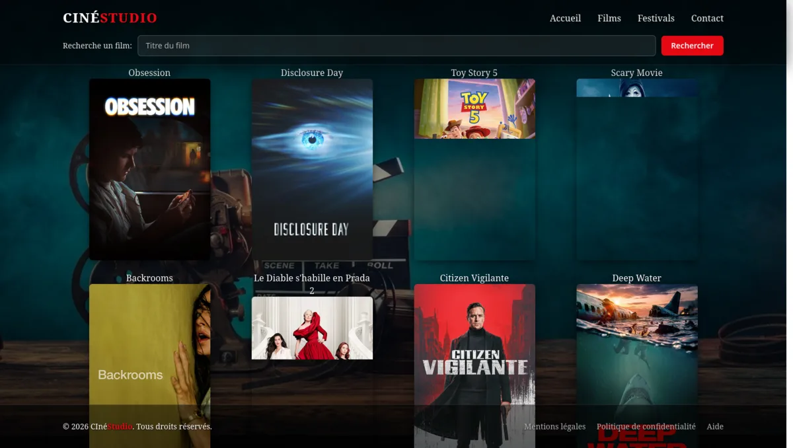
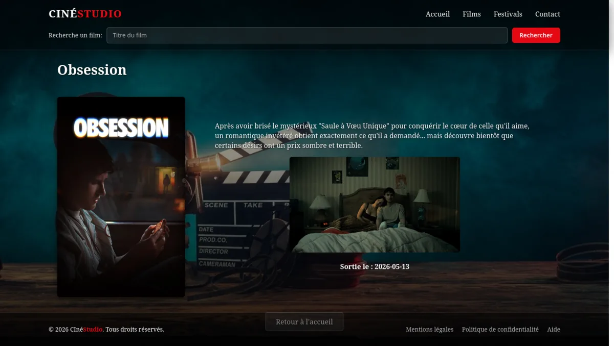

<div align="center">

# 🎬 CinéStudio

**Application de découverte de films inspirée de Netflix**

[](https://react.dev)
[](https://vite.dev)
[](https://expressjs.com)
[](https://sass-lang.com)
[](https://www.themoviedb.org)
[](LICENSE)

<sub>Projet d'école — Titre professionnel <strong>DWWM</strong> (Développeur Web &amp; Web Mobile)</sub>

[Fonctionnalités](#-fonctionnalités) · [Aperçu](#-aperçu) · [Stack](#-stack) · [Installation](#-installation) · [API](#-api) · [Auteur](#-auteur)

</div>

## ✨ Fonctionnalités

- **Catalogue** : parcours des films populaires avec affiches et notes.
- **Recherche** : recherche instantanée par titre.
- **Fiche film** : synopsis, date de sortie, note et affiche.
- **Thème sombre** : interface responsive inspirée de Netflix.
- **Deux sources de données** : 29 films en JSON local ou API TMDB en direct.
- **Fallback** : retour automatique au JSON local si TMDB est indisponible.
- **API REST** : liste, recherche, détail et tendances.

## 📸 Aperçu



<details>
<summary>Voir la fiche détaillée d'un film</summary>



</details>

## 🧱 Stack

| Couche | Technologies |
| --- | --- |
| **Frontend** | React 19 · React Router 8 · Vite 8 · Axios · Sass |
| **Backend** | Node.js · Express 5 · dotenv · CORS |
| **Données** | JSON local (29 films) · API TMDB (optionnelle) |
| **Qualité** | ESLint · Prettier |

## 🏗️ Architecture

```text
cinestudio/
├── src/                  # Interface React
│   ├── Films.jsx         # Catalogue
│   ├── SearchFilms.jsx   # Recherche
│   ├── DetailFilms.jsx   # Fiche film
│   └── ...
├── server/               # API Express
│   ├── movieRouter.js    # Routes /movies
│   ├── movies.json       # Catalogue local (29 films)
│   └── .env.example      # Clé TMDB
├── public/               # Images et icônes
└── docs/                 # Captures d'écran
```

Le client React interroge l'API Express. Le serveur utilise **TMDB** si `TMDB_API_KEY`
est définie, sinon le **JSON local**.

## 🚀 Installation

**Prérequis :** Node.js 20.19+ et npm.

```bash
# 1. Cloner le dépôt
git clone https://github.com/WinnyKing57/cinestudio.git
cd cinestudio

# 2. Installer et lancer le client
npm install
npm run dev
# → http://localhost:5173
```

Dans un second terminal :

```bash
# 3. Installer et lancer l'API
cd server
npm install
npm start
# → http://localhost:3000
```

> Le client utilise `http://localhost:3000` par défaut. Pour pointer vers une autre API,
> créez un fichier `.env` à la racine avec `VITE_API_URL=https://mon-api.example`.

## 🔌 API

| Méthode | Route | Description |
| --- | --- | --- |
| `GET` | `/movies` | Liste des films (TMDB ou JSON local) |
| `GET` | `/movies/search?q=...` | Recherche par titre |
| `GET` | `/movies/:id` | Détail d'un film |
| `GET` | `/movies/trending` | Tendances TMDB (clé requise) |

## 🔑 API TMDB (optionnel)

Par défaut, l'application fonctionne sans clé avec **29 films** dans `server/movies.json`.
Pour récupérer les films **en direct depuis TMDB** :

1. Créez un compte gratuit sur [themoviedb.org](https://www.themoviedb.org/settings/api).
2. Générez une clé **API Key (v3)**.
3. Copiez le fichier d'exemple et renseignez votre clé :

```bash
cp server/.env.example server/.env
```

```dotenv
TMDB_API_KEY=votre_cle_ici
```

Le serveur bascule automatiquement sur TMDB et revient au JSON local en cas d'erreur.

> **Sécurité :** la clé reste côté serveur, n'est jamais exposée au navigateur et
> `server/.env` est ignoré par Git. Seul `.env.example` est versionné.

## 📜 Scripts

| Commande | Dossier | Description |
| --- | --- | --- |
| `npm run dev` | racine | Lance le client Vite sur le port 5173 |
| `npm run build` | racine | Génère le build de production dans `dist/` |
| `npm run preview` | racine | Prévisualise le build de production |
| `npm run lint` | racine | Lance ESLint |
| `npm run format` | racine | Formate le code avec Prettier |
| `npm start` | `server/` | Lance l'API Express sur le port 3000 |

## 📄 Licence

Ce projet est distribué sous licence **MIT**. Voir [LICENSE](LICENSE).

## 👤 Auteur

**Edwin Duriez (WinnyKing)** — développeur web

[](https://github.com/WinnyKing57)
[](https://portfolio.winnyking.cloud)

<div align="center">
<sub>Projet réalisé dans le cadre de la formation <strong>DWWM</strong> · 2026</sub>
</div>
